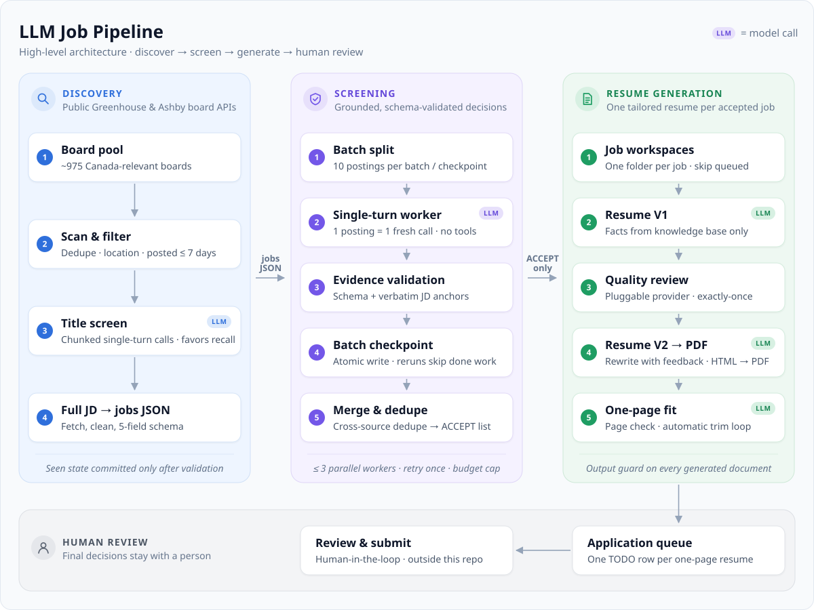
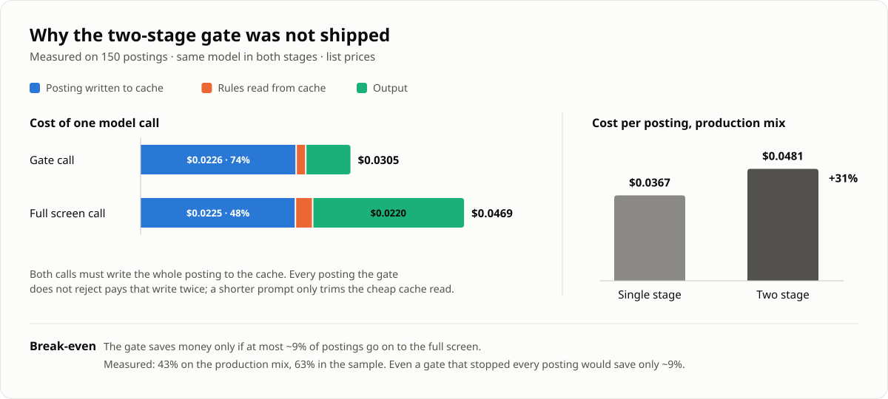

# llm-job-pipeline

[](https://github.com/Premiercouer/llm-job-pipeline/actions/workflows/ci.yml)


An LLM pipeline that triages large volumes of unstructured documents against a fixed rubric, backs every
decision with evidence quoted from the source, and generates a tailored document for each accepted item,
with cost, quality and failure behaviour measured rather than assumed.

The domain is job search: discover postings, screen each one against a candidate profile, and produce a
one-page resume for every match. The same pattern (classify with evidence → validate → generate →
review) carries over to ticket routing, compliance review or vendor matching.

> All candidate data in this repository is fictional. See [Privacy & scope](#privacy--scope).

## The problem

A daily sweep of employer job boards returns hundreds of new postings, and about 93% of them are a poor
fit (years of experience, seniority, required domain, language). Reading each posting and rewriting a
resume by hand takes most of a day. Keyword filters are fast but miss the point: the useful question is
whether the candidate has actually done the core responsibilities, and only reading the full
description answers it.

This pipeline lets the LLM do the reading and makes deterministic code responsible for everything else:
state, files, validation, retries, deduplication and spend.

## Results at a glance

Measured on the author's own daily runs (personal scale, 9 days of production use):

| | |
|---|---|
| Postings screened by reading the full description | **2,846** (2,686 unique after cross-source dedupe) |
| Model cost per screened posting | **$0.037** (1,890 production calls) |
| Cost change, single-turn vs. earlier tool-using worker (paired benchmark, n = 20) | **−82.3%** (95% CI −84.5% to −80.2%) |
| Agreement with prior decisions (stratified sample, n = 100) | **96 / 100** |
| Schema / evidence-check failures on first attempt | **0 / 121** requests |
| Accepted jobs that ended with a one-page tailored resume | **240 / 245** |
| Resume generation cost per job, after redesign (n = 8) | **−65%** ($1.17 → $0.41) |
| Design rejected on measurement: two-stage screening gate | **+31% cost** despite 0 false rejects → not shipped ([case study](#case-study-a-design-rejected-on-measurement)) |

Details and caveats: [Evaluation](#evaluation).

## Architecture



| Stage | Path | What it does |
|---|---|---|
| Discovery | [`discovery/`](discovery/) | Public Greenhouse / Ashby board APIs: build a board pool, pull recent postings, drop already-seen ones, screen titles with a single-turn LLM worker (high recall), fetch and clean full descriptions |
| Screening | [`screening/`](screening/) | One isolated LLM call per posting, a structured decision with quoted evidence, validation, batch checkpoints, merge and cross-source dedupe |
| Resume generation | [`resume/`](resume/) | V1 from a fixed bullet / skills library → external quality review → V2 → PDF → automatic trim until it fits one page → queue |
| Quality review | [`scoring/`](scoring/) | Provider interface plus a crash-safe state machine for any external scoring service (mock and manual providers included) |
| Shared | [`common/`](common/), [`config/`](config/) | Model-call interface (CLI and API backends), config and paths, candidate identity, single-turn worker runtime, output guard, pseudonymous telemetry |
| Evaluation | [`eval/`](eval/), [`docs/`](docs/) | Benchmark scripts, benchmark reports, decision records, the architecture diagram |
| Entry point | [`run_pipeline.py`](run_pipeline.py) | One command for the whole pipeline or a slice of it (`--from` / `--until`) |
| Demo & tooling | [`demo/`](demo/), [`tools/`](tools/) | Offline end-to-end demo, fake model CLI, test runner, public-safety scan |
| Example data | [`examples/`](examples/) | Fictional candidate (profile, bullet banks, skills) and 8 fictional job postings |

## What this repository demonstrates

This is **controlled LLM workflow orchestration**: deterministic code decides the order of the steps,
and every model call is a single, validated, function-like call (system prompt and input in, JSON out).
It is not an autonomous agent system; there is no dynamic planning, tool choice or multi-agent
conversation.

- **Shipping an LLM workflow that is used every day**: an end-to-end automation from raw postings to a
  reviewed document, with human sign-off at the point of no return, rather than a notebook demo.
- **Evaluating and constraining LLM output**: schema validation, verbatim evidence checks against the
  source text as a hallucination control, paired benchmarks with confidence intervals, and a cost model
  detailed enough to reject a design that passed every quality check
  ([case study](#case-study-a-design-rejected-on-measurement)).
- **Collecting data at scale and classifying it with an LLM**: public-API discovery across ~975 company
  boards, deduplicated incrementally, then semantic screening with a rubric the model must justify.
- **Engineering for cost, failure and untrusted input**: prompt caching, budget caps, checkpoint and
  resume, failure classification with a circuit breaker, one model-call interface over the CLI and the
  Messages API, and layered defences against prompt injection from scraped text.

## Case study: a design rejected on measurement

**Hypothesis.** Most postings fail on a hard rule (years of experience, seniority, language, student
status). A short "hard-reject gate" call could reject the clear cases cheaply, and only the rest would
go on to the full screen. The goal was lower cost **without a single extra false reject**.

**Experiment.** 150 stratified postings, with all 35 historical ACCEPTs run first under a stop rule,
plus 30 postings run end to end through both stages: 170 model calls, $5.68. Every gate reject and
every borderline case was reviewed by hand.

**Quality: the gate was safe.** All 55 high-confidence rejects were correct (Wilson 93.5%–100%), and
0 of 35 acceptable jobs were rejected. Postings that a keyword filter would get wrong ("3–5 years …
preferred", "or equivalent" referring to the degree) were all passed on to the full screen.

**Cost: it went up.**



| Per call | Posting written to cache | Rules read from cache | Output | Total |
|---|---|---|---|---|
| Gate | $0.0226 (74%) | $0.0014 | $0.0065 | $0.0305 |
| Full screen | $0.0225 (48%) | $0.0025 | $0.0220 | $0.0469 |

Per-token prices fitted from the measured calls reproduce every reported cost to within $0.00001, so
this breakdown is exact, not estimated. It explains the result:

- Every call has to write the whole posting into the prompt cache, and that write dominates the cost.
  Each posting that passes the gate pays for it twice.
- A shorter gate prompt only reduces the cache *read*, which was already almost free.
- The single-stage worker already stops early and cheaply on hard rejects (about $0.0335), so ending
  a posting at the gate saves almost nothing.

**Break-even.** The gate pays off only if at most ~9% of postings go on to the full screen; even a gate
that stopped every posting would save only ~9%. Measured: 43% on the production mix (63% in the
sample). Net effect: +31% per posting ($0.0367 → $0.0481).

**Decision.** Not shipped; production stays single-stage. What would change the decision: a gate
model cheap enough to cost ≤ ~$0.012 per call (for a 20% saving), or a deterministic pre-filter for
unambiguous patterns, which would first need its own precision study.

**Takeaway.** For this workload, cost is driven by how many times each posting is sent to a model,
not by prompt length. Full write-up: [docs/decisions/two_stage_gate.md](docs/decisions/two_stage_gate.md).

## Example: one screening decision

The real model's output for the fictional *Junior Data Scientist* posting in
[`examples/job_postings/`](examples/job_postings/greenhouse_sample.json), screened against the fictional
candidate. Every `jd_anchor` is checked to appear verbatim in the posting before the result is accepted.

```json
{
  "hard_reject": { "hit": false, "type": null, "jd_anchor": null },
  "core_responsibilities": [
    { "responsibility": "Feature engineering on large booking datasets using PySpark",
      "jd_anchor": "engineer features from large booking datasets with PySpark", "match": "DIRECT" },
    { "responsibility": "Train and evaluate classification and forecasting models with scikit-learn and XGBoost",
      "jd_anchor": "train and evaluate classification and forecasting models with scikit-learn and XGBoost", "match": "DIRECT" },
    { "responsibility": "Benchmark models against baselines",
      "jd_anchor": "compare models against baselines", "match": "DIRECT" },
    { "responsibility": "Present model results to product managers",
      "jd_anchor": "present results to product managers", "match": "ADJACENT" }
  ],
  "main_gap": { "type": "ADJACENT",
                "description": "No airline or travel-industry domain experience, though the role does not require it." },
  "decision": "ACCEPT",
  "reason": "The core work of PySpark feature engineering and training and evaluating XGBoost/scikit-learn classification and forecasting models directly matches the candidate's strong evidence, and the only gap is airline domain familiarity in a role open to recent graduates."
}
```

(`source_key` and `anchor_direct_match` omitted.) For the *Senior Data Engineer* posting, the same worker
stops at the hard-reject check: `{"hit": true, "type": "SENIORITY", "jd_anchor": "You will mentor a team of
four engineers"}`, with no responsibility mapping.

## Tech stack

- **Python 3.11+**, standard library only, except [PyMuPDF](https://pymupdf.readthedocs.io/) for PDF page
  checks.
- **Claude** (Opus) behind one call interface ([`common/llm.py`](common/llm.py)) with two backends: the
  [Claude Code CLI](https://docs.anthropic.com/en/docs/claude-code) in non-interactive mode (`claude -p`,
  the default), or the Messages API through the official
  [`anthropic`](https://github.com/anthropics/anthropic-sdk-python) SDK (`--backend api`, optional
  extra). Both are single-turn: no tools, the rules in the system prompt, JSON out.
- **Headless Chrome / Chromium** to render resumes from HTML to PDF.
- **GitHub Actions** for tests, the offline demo and the public-safety scan.

## Quickstart: offline demo

No API key, network or account is needed. The demo runs the real pipeline code on 8 fictional postings.
The model is replaced by [`tools/fake_claude.py`](tools/fake_claude.py), a deterministic stand-in that
follows the same single-turn contract and passes every validator and guardrail; the review provider is
`scoring.mock`.

```bash
git clone https://github.com/Premiercouer/llm-job-pipeline.git
cd llm-job-pipeline
pip install "pymupdf>=1.24"
python3 demo/run_demo.py
```

Requirements: Python 3.11+. Chrome or Chromium is needed for PDF rendering; set `CHROME_BIN` if it is
not found automatically (without it the demo skips the PDF step).

The demo prints each stage's progress, the decision for each posting and the path of each generated
resume. Artefacts go to `workspace/demo/` (git-ignored). The end of the output:

```text
=== Summary
screened 8 | ACCEPT 5 | REJECT 3 | UNABLE 0
  ACCEPT   Contoso Retail — Data Analyst
  ACCEPT   Woodgrove Bank — Business Intelligence Analyst
  ACCEPT   Tailspin Analytics — Junior Data Scientist
  ACCEPT   Litware Health — Analytics Engineer
  ACCEPT   Proseware Logistics — Operations Data Analyst
  REJECT   Adventure Works — Senior Data Engineer (REQUIRED_EXPERIENCE)
  REJECT   Wide World Importers — Data Analyst (Bilingual) (LANGUAGE)
  REJECT   Alpine Ski House — Data Analytics Co-op Student (STUDENT_ELIGIBILITY)
  resume: Tailspin Analytics — Junior Data Scientist | review score 83 | PDF resume/jobs/<batch>/Junior_Data_Scientist__Tailspin_Analytics__<id>/resume.pdf
  ...
```

The fake model is rule-based, so its decisions and resume text show the pipeline's mechanics rather
than the real model's judgement (see the [example above](#example-one-screening-decision) for that).

## Running for real

1. Install and log in to the [Claude Code CLI](https://docs.anthropic.com/en/docs/claude-code). Workers
   are started through it; set `CLAUDE_BIN` if it is not on `PATH`.
2. `cp config/example.toml config/local.toml` and point `candidate_dir` at your own candidate folder
   (same layout as [`examples/candidate/`](examples/candidate/)). Every setting can also be given as an
   environment variable (`LJP_WORKSPACE`, `LJP_CANDIDATE_DIR`, …).
3. Build each source's board pool once: `discovery/greenhouse/01_filter_greenhouse_boards.py` (plus
   `02_scan_greenhouse_source_b.py`) and `discovery/ashby/00_initialize_board_pool.py`.
4. Run everything with one command:

   ```bash
   python3 run_pipeline.py                       # discovery → screening → resume, both sources
   python3 run_pipeline.py --from screening      # reuse existing discovery outputs
   python3 run_pipeline.py --dry-run             # print the plan
   ```

   [`run_pipeline.py`](run_pipeline.py) runs each stage's own script in order and stops at the first
   failure; stages keep their checkpoints, so a rerun continues where it stopped. The steps are:
   - **Discovery** (per source): `scripts/01_search_jobs.py` scans the boards →
     [`discovery/title_screen.py`](discovery/title_screen.py) screens the new titles with single-turn
     model calls in chunks, and writes results only if every title is covered →
     `01_search_jobs.py --phase finalize` validates them and commits seen state → Greenhouse only:
     `scripts/02_fetch_jd.py` fetches and cleans the full descriptions.
   - **Screening:** `screening/split_<source>.py` → `screening/scripts/02_run_screening.py` →
     `03_merge_results.py`.
   - **Resume generation:** `resume/script/01_prepare_jobs.py` → `02_generate_v1.py` →
     `03_review_resumes.py` → `04_generate_final.py` → `05_enqueue_applications.py`.

   `--limit-boards N` makes a discovery-only trial run on a few boards, using the stages' test paths.
   `--backend api` (or `api:<model>`) runs the title screen and screening through the Messages API
   instead of the CLI: `pip install ".[api]"` and set Anthropic credentials (for example
   `ANTHROPIC_API_KEY`).
5. Plug in your own review service with `--provider module:factory` (any object implementing the
   `ResumeScorer` protocol in [`scoring/models.py`](scoring/models.py)).

Useful flags: `--workers N` (parallel screening calls), `--max-budget-usd X` (hard screening spend cap),
`--model M` (every worker), `--sources ashby` (one source). Each stage script also runs on its own.

## Key design decisions

**1. The model judges; code owns everything else.** Each posting gets its own fresh, single-turn,
tool-less model call. Rules and the candidate profile go into the system prompt, and the posting is the
user message. Python owns files, state, retries and deduplication. Guardrails stop the run if a call
takes more than one turn, attempts a tool, changes model mid-run, or runs with a system prompt whose hash
differs from the source files.
[`common/single_turn.py`](common/single_turn.py), [`screening/scripts/screening_core.py`](screening/scripts/screening_core.py)

**2. Every decision has to quote its evidence.** The structured result lists the core responsibilities,
how the candidate matches each one (DIRECT / ADJACENT / LEARNABLE / STRUCTURAL), and an anchor copied
from the posting. Each anchor must appear verbatim (after normalisation) in the source text, otherwise
the result is rejected. This is a cheap, deterministic check against invented requirements.

**3. Failures are classified, not just retried.** Each batch of 10 is checkpointed atomically, so a
rerun skips finished work. A transient error gets one fresh retry. An input that will fail the same way
again ("prompt too long") is not retried. An environment failure (not logged in, 401/403, CLI rejects
its arguments) is treated as global: queued work is cancelled, running workers are stopped, finished
checkpoints are kept, and the run exits non-zero.

**4. Cross-source deduplication without trusting company names.** The same job shows up on several
boards under different company spellings. Two postings are treated as duplicates when ≥ 80% of the
shorter title's words appear in the other title and their descriptions share ≥ 85% of 5-word shingles.
Titles that differ by one seniority word (e.g. Senior vs. Lead) are kept apart. Measured overlap: true
duplicates 0.89–1.00, distinct jobs with the same title ≤ 0.70.
[`screening/scripts/03_merge_results.py`](screening/scripts/03_merge_results.py)

**5. Scraped text is untrusted input.** A job description can contain instructions aimed at the model.
Workers have no tools, so they cannot read files or open URLs. The single-turn guardrail rejects
multi-turn attempts. Before generated text can leave the machine, [`common/output_guard.py`](common/output_guard.py)
rejects any link or e-mail address that is not the candidate's own (links copied from the posting
included), credential-like strings, and fragments of the worker's own prompt.

**6. Exactly-once calls to an external service.** Quality review talks to a third-party scorer with a
limited quota, so a duplicate submission costs money and an unrecorded one loses work. The engine writes
the intent to an fsynced journal before submitting, never submits blindly a second time, accepts only
results that are fresh and fingerprint-matched, commits before checkpointing, and on restart reconciles
from the journal instead of starting over.
[`scoring/engine.py`](scoring/engine.py)

**7. Cost is a design input.** The large shared prefix (rules plus profile) is prompt-cached. One
posting is screened serially first to warm the cache before the parallel pool starts. Per-call cost and
tokens are recorded, and `--max-budget-usd` reserves an estimate before each launch.

**8. One call contract, two runtimes.** [`common/llm.py`](common/llm.py) defines a single model call:
system prompt and input in, text plus normalized usage out, and exactly three failure classes: *transient* (retry once), *input* (this input can never succeed) and
*fatal* (stop the run). The CLI backend and the Messages API backend map their own errors onto those
classes. The title screen uses it for every call, and screening uses it whenever `--backend api` is
set. In screening, the API path reuses the same prompt hashing, single-turn and cache-context
guardrails, budget and validation as the CLI path, so a backend comparison measures the model, not
the harness ([`eval/compare_models.py`](eval/compare_models.py)). Two deliberate choices: the SDK's own
retries are off, so the pipeline's retry policy is the only one; and server-side refusal fallbacks are
opt-in, because a run must use a single model, so a declined posting fails on its own instead of being
answered by another model.

**9. Designs are costed before they ship.** A two-stage gate that passed every quality check was
rejected because it raised cost by 31%. See the [case study](#case-study-a-design-rejected-on-measurement).

## Evaluation

| Study | Sample | Result | Report |
|---|---|---|---|
| Screening: single-turn vs. earlier tool-using worker | 20 paired postings | Cost −82.3% (95% CI −84.5% to −80.2%), input tokens −64.8%, latency −16.5% | [screening_single_turn.md](docs/benchmarks/screening_single_turn.md) |
| Screening: decision quality | 100 stratified postings | 96/100 agree with prior decisions; 1 confirmed false reject among 25 prior ACCEPTs | [screening_single_turn.md](docs/benchmarks/screening_single_turn.md#quality) |
| Screening: format stability | 121 requests | 0 first-attempt schema / evidence failures | [screening_single_turn.md](docs/benchmarks/screening_single_turn.md#setup-and-guardrails) |
| Discovery: title-screen worker vs. earlier agent-session decisions | 308 historical titles | 90.6% agree; 79/85 earlier accepts kept; more permissive overall (102 vs 85 accepted) | [title_screen_worker.md](docs/benchmarks/title_screen_worker.md) |
| Screening: two-stage gate (rejected) | 150 postings + 30 end to end | 55/55 gate rejects correct, 0/35 false rejects; cost +31–38% | [two_stage_gate.md](docs/decisions/two_stage_gate.md) |
| Resume: single-turn vs. earlier tool-using worker | 8 jobs + 3 prompt-injection cases | Cost per job $1.17 → $0.41; 8/8 one page; 0 unsupported numbers; injected instructions not followed | [resume_single_turn.md](docs/benchmarks/resume_single_turn.md) |

Caveats: samples are small, so these are go / no-go checks, not precise effect estimates. "Agreement"
compares against the pipeline's own earlier decisions, not against an independent human label.

## Testing & CI

- 184 offline tests across the model-call layer, discovery, screening, quality review and resume generation, standard
  library `unittest` only: `python3 tools/run_tests.py`.
- [`tools/fake_claude.py`](tools/fake_claude.py) stands in for the model CLI, so guardrails, retries and
  failure paths are tested without network or spend. One test runs the real hand-off end to end: a
  stage 01 prepare artifact → the title-screen worker → stage 01 finalize. The API backend runs
  against a fake SDK that mirrors the `anthropic` package's exception classes and responses: request
  shape, error mapping, refusals, usage and cost, and the screening guardrails on that path.
- CI ([`.github/workflows/ci.yml`](.github/workflows/ci.yml)) runs the tests on Python 3.11–3.13, runs the
  offline demo end to end through `run_pipeline.py` and uploads the generated PDFs, and runs a public-safety scan
  ([`tools/check_public_safety.py`](tools/check_public_safety.py)) for secrets, home paths, personal
  contact details and private file types.

## Privacy & scope

- **Fictional candidate.** [`examples/candidate/`](examples/candidate/) is invented. The real profile,
  resumes, application history and raw job descriptions are kept outside the repository and never
  committed.
- **Included sources: public APIs only.** Only Greenhouse and Ashby discovery are published, because
  both are public job-board APIs. The author's private setup collects from seven job platforms: these
  two plus five private sources, which screen broadly before requesting full descriptions
  ([discovery](discovery/README.md#private-workflow-and-published-scope)). That code is not included
  and is not needed to run the pipeline. Any source that writes the same JSON shape can feed the
  screening stage.
- **External scoring is an interface.** `scoring/` ships the protocol, the state machine and mock / manual
  providers. Integrations with specific commercial services are out of scope.
- **Submitting applications is out of scope.** The pipeline stops at a queue that a person reviews.
- **Telemetry is pseudonymous.** Job identifiers in usage logs are salted hashes
  ([`common/pseudonym.py`](common/pseudonym.py)).

## Limitations & future work

- Built for one user at personal scale: hundreds of postings a day, not millions. No service, queue or
  database; workers are local CLI processes.
- The Messages API backend covers the title screen and screening; the resume workers still call the
  CLI directly. The API backend is tested offline against a fake SDK only. No real CLI-vs-API or
  cross-model comparison has been run yet; `eval/compare_models.py` is ready for one.
- Evaluation samples are small, and screening quality has not yet been measured against independent
  human labels.
- One rubric rule is under-specified: whether a hard 1–2 year minimum counts as a required-experience
  reject (the rubric's examples start at 3+ years). Borderline postings of this kind can flip between
  runs. The benchmark found it; it has not been resolved yet.
- Not yet built: embedding-based retrieval / deduplication, and a containerised deployment.

## License

[MIT](LICENSE)
