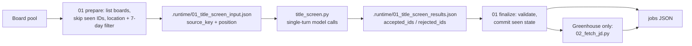
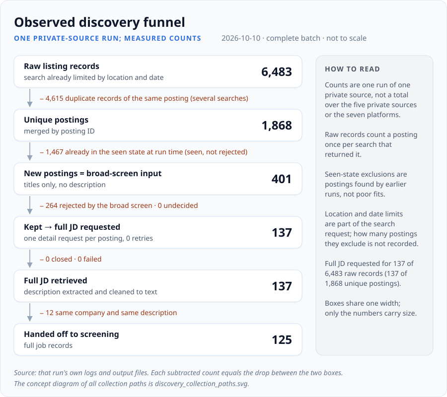

# Discovery

## Purpose

Find new, relevant postings on public job boards and hand them to [screening](../screening/README.md)
as a standard jobs file. Two sources are published: **Greenhouse** and **Ashby**, both public
board APIs that need no account. Discovery is cheap on purpose: it filters by location, freshness
and job title only. Whether the candidate fits a role is decided later, from the full description.

## Inputs and outputs

| | Greenhouse | Ashby |
|---|---|---|
| Board pool | built once by `01_filter_greenhouse_boards.py` (a public board directory) and `02_scan_greenhouse_source_b.py` (a second public list), merged into `outputs/greenhouse_boards_relevant_merged.json` | committed in [`ashby/config/ashby_board_pool.json`](ashby/config/ashby_board_pool.json) (297 boards), rebuilt by `00_initialize_board_pool.py` |
| Listing call | `boards-api.greenhouse.io/v1/boards/{token}/jobs` | the Ashby posting API, which includes the plain-text description |
| Stable ID / seen state | `greenhouse:{board_token}:{job_id}` in `.runtime/greenhouse_seen_jobs.json` | `ashby:{board_slug}:{id}` in `.runtime/ashby_seen_jobs.json` |
| Freshness | `updated_at` ≤ 7 days at stage 01, then `first_published` ≤ 7 days at stage 02 | `publishedAt` ≤ 7 days |
| Full description | fetched per job by `scripts/02_fetch_jd.py`, HTML cleaned to text | already in the listing (`descriptionPlain`) |
| Final output | `outputs/YYYY-MM-DD_HHMM_greenhouse_jobs.json` | `outputs/YYYY-MM-DD_HHMM_ashby_jobs.json` |

All paths are relative to `<workspace>/discovery/<source>/` (see [`common/paths.py`](../common/paths.py)).
Both final files use the same five-field job schema that screening reads:

```json
{"date": "YYYY-MM-DD", "job_count": 1,
 "jobs": [{"company": "...", "position": "...", "jd": "...", "apply_url": "...", "source_key": "..."}]}
```

## How it works



1. **Prepare** lists every board in parallel, drops postings whose stable ID is already in the seen
   state, keeps postings in the Greater Toronto Area or explicitly remote within Canada, applies
   the 7-day window and writes the titles to screen. Unseen IDs are only *staged* at this point.
2. **Title screen** ([`title_screen.py`](title_screen.py)) sends the titles in chunks of 150 to a
   single-turn, tool-less model call with the source's
   [`instructions/title_screening.md`](greenhouse/instructions/title_screening.md) as the system
   prompt. Each chunk must come back as an exact partition of its input (every ID once, no unknown
   IDs). A bad chunk gets one retry; if it still fails, no results file is written.
3. **Finalize** validates the results file again, writes the candidate output and only then
   commits the new IDs to the seen state, in one atomic write.
4. **Greenhouse stage 02** fetches each candidate's description, re-checks freshness on
   `first_published` and writes the final jobs file.

The title rules say "when uncertain, keep": a title is rejected only when it is clearly outside
data / analytics / ML / research / finance-analysis work. That is a design goal. Its recall has not
been measured against labels; the one check so far compares the worker with earlier decisions
([title-screen check](../docs/benchmarks/title_screen_worker.md)).

**Boundary with screening.** The title screen sees only `source_key` and `position`. It never sees
the description, the candidate profile or the rubric, and it never decides fit. Everything it keeps
is read in full by screening. Duplicates *across* sources (the same job on two boards) are not
handled here; screening's merge step detects them.

## Design choices

- **Seen state is committed last.** A crash, a failed title screen or an invalid output leaves the
  seen state untouched, so the next run sees the same postings again instead of losing them
  ([`greenhouse/scripts/01_search_jobs.py`](greenhouse/scripts/01_search_jobs.py)). The cost is
  that a failed run repeats its listing calls.
- **The model call is a separate, replaceable step.** Prepare and finalize contain no model calls;
  the worker between them can be `title_screen.py` or an interactive session that writes the same
  results file, and finalize validates it the same way either way.
- **Titles are untrusted input.** The worker has no tools, the titles sit inside an explicitly
  untrusted block, and anything other than an exact partition is rejected.
- **No keyword filter in Python.** Title relevance is left to the model with permissive rules,
  because keyword lists misjudge vague or unusual titles; the trade-off is one model call per 150
  titles.

## Run

From the repository root (real network calls to public board APIs; the title screen is a real
model call):

```bash
python3 run_pipeline.py --until discovery                        # both sources
python3 run_pipeline.py --until discovery --limit-boards 5 --sources ashby   # trial run on test paths
```

Or step by step for one source:

```bash
python3 discovery/greenhouse/scripts/01_search_jobs.py
python3 discovery/title_screen.py --source greenhouse [--max-budget-usd 1]
python3 discovery/greenhouse/scripts/01_search_jobs.py --phase finalize
python3 discovery/greenhouse/scripts/02_fetch_jd.py
```

`--limit-boards N` switches stage 01 to separate test seen-state, checkpoint and output paths;
`title_screen.py --test` reads and writes the matching test files. `title_screen.py --backend api`
uses the Messages API instead of the CLI ([`common/`](../common/README.md)).

## Validation and limitations

- Tests: `python3 tools/run_tests.py discovery` (fake board responses and the fake model CLI;
  includes the prepare → worker → finalize hand-off).
- [Title-screen check](../docs/benchmarks/title_screen_worker.md): 90.6% agreement with earlier
  agent-session decisions on 308 Ashby titles; the worker kept more titles than before. One
  source, one snapshot, no human labels.
- Location matching is rule-based (place names and remote-in-Canada wording) and tuned for one
  region.
- Board pools are snapshots of public directories; boards that move to another ATS drop out until
  the pool is rebuilt.
- The per-source `AGENTS.md` files are operating notes for interactive sessions, written relative
  to the source folder.

## Private workflow and published scope

Background on the author's private setup. It does not replace the steps and commands above.


- The private workflow collects from seven job platforms. This repository publishes two of them,
  the Greenhouse and Ashby adapters, and they run on their own without the others.
- The five additional private job sources share one order: a broad screen first, then a full
  description request only for the postings it keeps. Their collection code is not in this
  repository, and `run_pipeline.py` and `title_screen.py` do not drive them.
- Ashby's listing response already contains the description. Greenhouse requests each description
  from its detail API after the broad screen.
- Every path ends in the same full job record, which then goes through the same screening,
  deduplication and resume stages.
- Why this order: requesting full descriptions only for kept postings skips detail requests for
  postings the broad screen drops anyway. The size of that saving has not been measured.
- Historical run figures, such as those in [operational experience](../docs/operational_experience.md),
  come from the private multi-source setup. They are not results of running only the two published
  adapters.

The private lane in the diagram shows only what all five sources share. Each source collects in
its own way; details from one of them should not be read as true for the others.

### Observed discovery funnel

**One private-source run; measured counts.** One complete batch from one of the five private
sources, run on 2026-10-10. The counts come from that run's own logs and output files. They are
not totals over the five private sources or the seven platforms, and other runs differ in volume.



| Stage | Input | Excluded or failed | Retained | Meaning |
|---|---:|---:|---:|---|
| Location / date filter | not recorded | not recorded | — | applied by the search request before listings come back; the number it excludes is not visible |
| Raw listings retrieved | — | — | 6,483 | listing records returned by the source's searches; a posting returned by several searches counts once per search |
| Within-source duplicates merged | 6,483 | 4,615 | 1,868 | records for the same posting ID merged; 1,868 unique postings |
| Previously seen excluded | 1,868 | 1,467 | 401 | already in the seen state when the run read it; seen before, not judged a poor fit |
| Broad screen | 401 | 264 rejected | 137 | title-only screen; 0 undecided |
| Full JD retrieval | 137 | 0 closed, 0 failed | 137 | one detail request per kept posting (137 requests, 0 retries) |
| Exact content duplicates removed | 137 | 12 | 125 | same company and same description after normalisation |
| Handed off to screening | 125 | — | 125 | full job records in the screening input for that day |

In this run, the full description was requested for 137 of 6,483 raw listing records (137 of 1,868
unique postings). That count is about requests in one run of one source. It is not a measured cost
saving, and it does not apply to Ashby, whose listing already includes the description.

The seen-state count is the number the run logged when it compared its listings with the state it
loaded, not a figure worked out from today's state file. Percentages are left out because the
useful denominator depends on the question.

## Key files

| File | Role |
|---|---|
| [`title_screen.py`](title_screen.py) | title-screen worker shared by both sources |
| [`greenhouse/scripts/01_search_jobs.py`](greenhouse/scripts/01_search_jobs.py) | Greenhouse prepare / finalize, seen state |
| [`greenhouse/scripts/02_fetch_jd.py`](greenhouse/scripts/02_fetch_jd.py) | description fetch, final freshness check, cleaning |
| [`ashby/scripts/01_search_jobs.py`](ashby/scripts/01_search_jobs.py) | Ashby prepare / finalize |
| [`greenhouse/01_filter_greenhouse_boards.py`](greenhouse/01_filter_greenhouse_boards.py), [`ashby/00_initialize_board_pool.py`](ashby/00_initialize_board_pool.py) | one-time board-pool builders |
| [`*/instructions/title_screening.md`](ashby/instructions/title_screening.md) | title rules (model-facing) |
