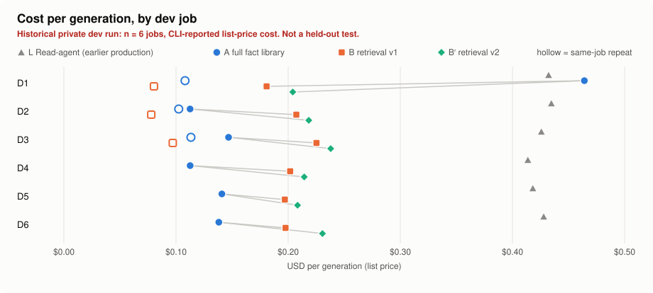
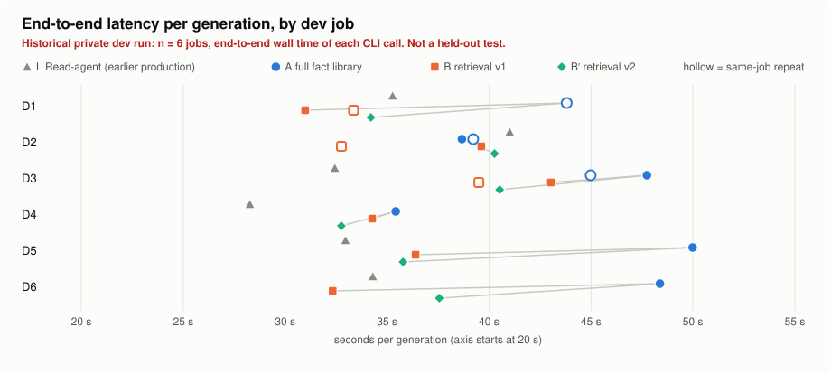
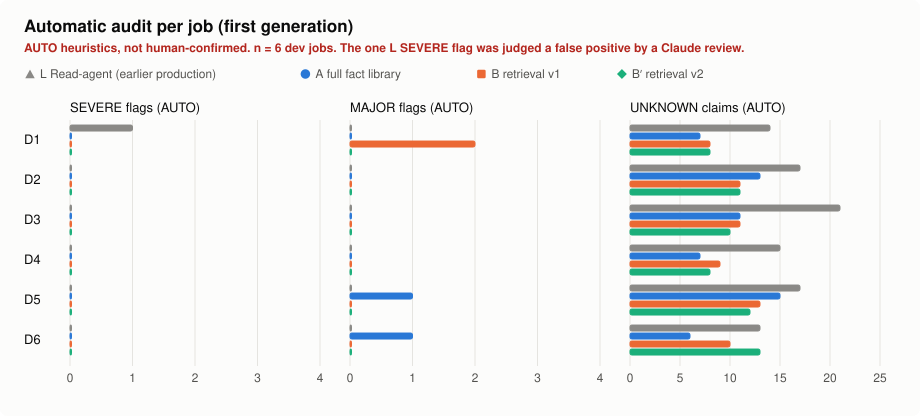

# Candidate-fact RAG for resume generation

**Status: implemented and evaluated on a 6-job development run; not adopted.** Resume generation
keeps the full candidate fact library in a single cached prompt.

**Conclusion.** Retrieving only the relevant candidate facts (BM25 + TF-IDF/LSA, grouped by
employer and project) cut the input context by 64–68% and made generations about 7–8 s faster
(measured). It did not make them cheaper: the full-text prompt is identical for every job, so after
the first job it is served from the prompt cache, while each retrieved bundle is new and pays a
cache write. Generating jobs back to back, full text was cheaper from the 5th job on (estimated).
Retrieval also left out evidence that both comparison arms chose to use: in 2 of 6 jobs the
project that both other arms put on the resume was not in the retrieved context. A tuned retrieval
configuration recovered one of the two. The automatic fact audit raised no SEVERE flag for A, B or
B′ (MAJOR counts differed: 2, 3 and 0), but quality differences between the arms were not
verified by a person.

This directory has two parts:

- **historical results** (`results/historical_dev/`): anonymized numbers from the real run, which
  happened in a private workspace with the real candidate and real job descriptions;
- **a public port** of the implementation (`fact_rag/`) that runs on the fictional candidate in
  [`examples/candidate/`](../../examples/candidate/), with an offline demo and tests. No
  historical number was re-measured on the port.

### One claim, traced end to end (illustrative)

From the offline demo (`scripts/demo.py`, default settings): fictional candidate, invented JD,
fake generator. It shows the mechanism, not real-model quality or a historical result.

| Step | What happens | Output |
|---|---|---|
| JD requirement | the "What You Will Do" section becomes a responsibility query | "Pull shipment events from carrier REST APIs and join them to internal orders" |
| Retrieved fact | best match among the Northwind Freight work bullets (BM25 1.00, LSA 0.95, fused score 1.198); kept by that employer's quota | `NWF-B05`: "Pulled shipment status from a carrier REST API in Python to enrich internal records with delivery timestamps, raising delivery-date completeness from 72% to 96%." |
| Evidence package | 21 of 42 facts (~1.6K of ~2.5K tokens) go to the generator; the bundle records which IDs it contained | context hash `64992e5dcc5a`, corpus hash `3261fd63796d` |
| Generated sentence | Northwind Freight experience bullet 3, with its citation (the fake generator copies the fact; a real model would rephrase it) | `{"text": "Pulled shipment status from a carrier REST API in Python … from 72% to 96%.", "fact_ids": ["NWF-B05"]}` |
| Source | provenance sidecar entry for the cited fact | `northwind_freight_bullet_bank.md`, lines 29–33, content hash `1b7fc717aea850c4` |
| Check | the citation exists, was in the package and belongs to the same employer; 72% and 96% appear in the cited fact with the same unit; Python and REST API appear in it | `SUPPORTED_AUTO`, no flags |
| Counter-example | the demo also changes "24 standardized care-category labels" to 36 in another bullet | `FAIL_AUTO`: `NUMBER_NOT_IN_CORPUS` |

| Label | Meaning |
|---|---|
| **measured** | usage, cost and latency reported by real model calls in the private run |
| **estimated** | computed from measured values (for example a batch-cost model) |
| **automatic check** | deterministic heuristics (schema, citation and fact audit); AUTO verdicts, not ground truth |
| **Claude review** | read and judged by Claude, not by a person |
| **unverified** | recorded in the private notes, not reproducible from the published data |

## 1. Problem and hypothesis

The Resume V1 worker writes a tailored resume from a library of candidate facts: work bullets,
course projects, a skills vocabulary. Sending the whole library with every job costs input tokens
and may bury the relevant facts. **Hypothesis:** retrieving the facts relevant to the job and
requiring the model to cite them reduces context, cost and latency without losing relevant
evidence or adding factual errors. The experiment did not assume RAG would win; the allowed
outcomes were adopt, keep full text, adopt under conditions, or insufficient evidence.

## 2. Arms and how they differ from production

| | L: earlier production | A: full fact library | B: retrieval v1 | B′: retrieval v2 |
|---|---|---|---|---|
| Call | `claude -p --agent` with the `Read` tool, ~6 turns | single turn, no tools | same as A | same as A |
| Candidate facts | raw knowledge markdown, read by the model | every canonical fact (~46.7K input tokens per call) | retrieved subset: 3 projects, ~4.0K evidence tokens (estimated; 15.1K input measured) | 8 projects, ~5.3K evidence tokens (estimated; 17.0K input measured) |
| Output | plain text | structured JSON, every claim carries `fact_ids`; Python renders the text and fills in identity | same as A | same as A |
| Model / effort | inherited model, CLI default effort | `claude-opus-5-5`, high | same | same |

- **A vs B is the controlled comparison**: same rules, prompt template, renderer, fact order and
  output contract; only the facts inside `<candidate_evidence>` differ.
- **L is a reference only.** L→B changes four things at once (agent→single turn, plain→cited
  output, markdown→fact format, full→retrieved), so L vs B says nothing about retrieval itself.
  L is the agent design this repository now keeps as a rollback (`--worker agent`).
- **The current default is close to A, not identical.** Production V1 is single-turn and full-text
  ([benchmark](../../docs/benchmarks/resume_single_turn.md)) but embeds the knowledge files as they
  are and returns plain text, without the fact format and citations A used.
- B′ was chosen on these same 6 dev jobs after B v1, then frozen. It is a dev-tuned configuration,
  not a held-out result.

## 3. Method

- **Jobs.** 6 development-split jobs, sampled from the private job pool with a fixed seed (the 4
  pilot jobs of the same split were never run). One generation per arm per job, plus a same-job
  repeat of A and B for 3 jobs: 30 generations, 0 retries, every first attempt valid.
- **Order.** Sequential, one process at a time. A/B order alternated per job; L at a random
  position. B′ ran in a second session against the first session's A results (cross-run pairing).
- **Cache state.** Each call is classified cold or warm from its own reported cache reads. A's
  first call was cold; its later calls read the cached prompt. B's bundles differ per job and were
  always cold, except same-job repeats within the cache lifetime.
- **Retrieval.** BM25 (own implementation) fused with TF-IDF + truncated SVD vectors (latent
  semantic analysis fitted on the 322 evidence facts; no neural embedding model was available or
  used), grouped selection and a token budget (section 7).
- **Quality checks (automatic).** Schema; citation validity (ID exists, was provided, right
  entity); a heuristic fact audit of every claim (numbers with units, tools, implementation
  limitations). Undecidable claims are UNKNOWN and never counted as passes.
- **Not done.** No pilot or held-out test run; 34 job labels exist only as unreviewed drafts; no
  blind human comparison; no human review of UNKNOWN claims; no LLM-judge.
- **Spend.** $6.83 at list price for everything, including a $0.06 preflight (measured; CLI-reported
  list-price equivalent, not subscription cash).

## 4. Results

### 4.1 Context, cost and latency

| Arm (generations) | Input tokens per call | Mean cost | Median latency | Turns | Evidence |
|---|---|---|---|---|---|
| L (6) | 52.1K | $0.425 | 33.6 s | 6 | measured |
| A (9) | **46.7K** | $0.160 | 43.8 s | 1 | measured |
| B (9) | **15.1K (−68%)** | $0.163 | 34.3 s | 1 | measured |
| B′ (6) | **17.0K (−64%)** | $0.219 | 36.7 s | 1 | measured |

Cost depends on the cache state, so the means above mix different situations. Split:

| Arm | Cold start | Warm, different job | Warm, same-job repeat |
|---|---|---|---|
| A | $0.464 (n = 1) | $0.130 (n = 5) | $0.108 (n = 3) |
| B | $0.202 (n = 6) | does not occur: each job's bundle is new | $0.085 (n = 3) |
| B′ | $0.219 (n = 6) | does not occur | not run |
| L | $0.425 (n = 6, all cold) | — | — |

A warm B call only happens when the same job is generated twice within the cache lifetime, which
the pipeline never does. **Paired by job (measured, job-level bootstrap 95%):**

| | Cost B − A, A warm (5 jobs) | Cost B − A, A cold (1 job) | Latency B − A (6 jobs) |
|---|---|---|---|
| B | **+$0.076** (+0.062 to +0.089) | −$0.283 | mean **−7.9 s** (−13.1 to −2.6), median −8.8 s; faster on 5 / 6 |
| B′ | **+$0.092** (+0.079 to +0.102) | −$0.260 | mean −7.2 s (−11.2 to −2.7), median −8.4 s; faster on 5 / 6 |

**Batch cost (estimated).** For N jobs generated back to back: A ≈ $0.464 + $0.122 × (N − 1),
B ≈ $0.202 × N. A is cheaper from N = 5 (N = 4 against B′); using A's first-generation warm mean
($0.130) instead gives the same N. Concurrent cold starts may duplicate cache writes; parallel cache
behavior was not evaluated.

A also wrote more: about 850 more output tokens per call and more thinking (2.9K vs 2.1K tokens),
which plausibly explains much of the latency gap. That was not isolated.
Retrieval itself is cheap: 0.9 s once to build the index, 112–165 ms per job (measured).

**Historical L, kept separate.** Production telemetry of the earlier L worker on other jobs and
days (44 calls, read-only): mean $0.419, median 35.6 s, median 6 turns; 10 of the 44 calls failed the
production output validation (34 passed). These calls are not paired with this run and are
not part of any comparison above.





### 4.2 Relevant evidence left out

There is no gold standard of "facts that should be used". As a proxy, each job was checked for
whether the project that L and A each put on the resume was in B's retrieved context (12 checks
over 6 jobs). L's and A's choices are model outputs, not correct answers.

| Retrieval config | L / A project in context | Jobs where L and A chose the same project and B lacked it | Evidence |
|---|---|---|---|
| B v1 (3 projects) | 6 / 12 | 2 (D2, D6) | measured retrieval manifests |
| B′ v2 (8 projects) | 9 / 12 | 1 (D2) | measured retrieval manifests |

In v1 the same project was in all 6 retrieved contexts: project ranking favoured a few projects.
One v1 bundle was flagged `RETRIEVAL_INSUFFICIENT` (13 of 42 answerable queries no longer
covered); the policy was "flag only", so it was generated anyway.

### 4.3 Automatic fact checks (heuristic, not human-confirmed)

| | L | A | B | B′ |
|---|---|---|---|---|
| SEVERE flags, first generations | 1 (judged a false positive by a Claude review) | 0 | 0 | 0 |
| MAJOR flags, all generations | 0 | 2 | 3 | 0 |
| Claims left UNKNOWN | 44% | 33% | 34% | 33% |
| Citations valid | — | 100% | 100% | 100% |



Zero SEVERE flags does not mean zero factual errors: about a third of all claims could not be
decided automatically, and the audit has known blind spots (section 5). The audit itself was
tested on constructed claims with planted defects: 15 / 18 before fixes and 18 / 18 after (that
set was then used to change the audit, so it is a regression test, not held-out evidence), 14 / 15
on a second set and 9 / 9 on a third set written after the last change. Calibration on historical
L resumes cut automatic flags from 1,309 to 63 over 8,987 claims; historical resumes are not ground
truth, so this measures noise, not accuracy.

**Not measured:** coverage of the job's supported requirements (labels never frozen), readability,
and how much a person would have to edit each resume. A provisional coverage figure computed with
the draft labels (0.70 for B v1 → 0.85 for B′) is recorded in the private notes but is unverified
and not published.

## 5. Cases

Job IDs (D1–D6) and project IDs are anonymized; resume and JD text are not published.

- **Where retrieval helps (measured).** D1 was A's cold start: B cost $0.181 against A's $0.464
  and was 12.8 s faster. When nothing can be cached, the smaller context is cheaper.
- **Where retrieval lost evidence (measured; relevance unverified).** In D2, L and A both chose
  the same project. B v1 did not retrieve it, and B′ ranked it 9th of 17 projects, just outside
  its 8-project window. Both retrieval arms built the resume around a different project instead;
  whether that project is a worse fit was judged by a Claude review only, not by a person.
- **Tuning that partly fixed it (measured, dev-tuned).** In D6, the project chosen by L and A
  ranked 7th, outside B v1's top 3; B′ retrieved it, but the generator then picked another
  project. In D1, A's project ranked 8th; B′ retrieved it and the generator used it.
- **An audit blind spot (Claude review).** In D1, A combined numbers from two different work
  bullets into one qualification sentence; each number exists in the cited facts, so the audit
  passed it. Merged or derived numbers are not caught.
- **An audit false positive (Claude review).** L's only SEVERE flag was a number derived from two
  corpus figures (a difference), which the audit attributed to the wrong project.

## 6. Decision

Keep the full-text, single-prompt context. For this workload (batches of jobs, one fact library
shared by all of them) prompt caching already removes most of the cost RAG was meant to save,
while retrieval adds a ranking step that can drop evidence the generator would have used.

**Re-evaluate when:**
- the fact library grows enough that even a cached full prompt is expensive or slow, or exceeds
  what fits comfortably in context;
- jobs are generated one at a time, far enough apart that the cached prompt expires, so cache hits
  become rare (concurrent cold starts may also duplicate cache writes; parallel cache behavior was
  not evaluated);
- latency matters more than cost;
- frozen human labels and a held-out test are available to measure evidence loss directly;
- a retrieval method with better project recall (for example a neural embedding model, or
  guaranteed per-project coverage) is available. None was tested here.

## 7. Implementation (public port)

```
fact_rag/
  corpus.py       candidate folder -> canonical facts: stable IDs (existing bullet IDs kept,
                  derived PRJnn-SECnn IDs for project facts), source file + line range,
                  content hash, corpus hash; vocabulary marked as non-evidence
  jd.py           JD sectioning (company, benefits, EEO, logistics dropped) -> typed, weighted queries
  embed.py        tfidf_lsa (TF-IDF + truncated SVD) and a hashing fallback for tests
  retrieval.py    BM25 + dense fusion; per-experience quotas, project ranking with mandatory
                  header / tech stack, per-rank fact caps, de-duplication, token budget,
                  sufficiency flag; a recorded score and reason for every candidate fact
  evidence.py     full / rag evidence bundles from one renderer; provided IDs and context hash
  prompts.py      system / user prompts on top of resume/instructions/resume_v1.md
  contract.py     cited JSON schema, plain-text rendering in the production layout, provenance sidecar
  verify.py       citation checks and fact checks against the cited facts only
  fake_model.py   deterministic stand-in generator plus planted defects (offline only)
  pipeline.py     wiring for one job
config/           demo retrieval settings, the historical B / B′ parameters, limitations, tool lexicon
scripts/          demo.py (offline), generate.py (opt-in real call), analyze_dev_results.py
tests/            30 offline tests
```

The production pipeline never imports `fact_rag`. The experiment needs `numpy` and `scikit-learn`
(`pip install ".[rag]"`); without them its numpy-dependent tests are skipped.

**Historical implementation vs public port**

| Historical (private) | Public port | Difference |
|---|---|---|
| corpus parser for the real candidate's files | `corpus.py` | entities come from `candidate.json`; the ATS list format of the fictional skills file is supported |
| JD query builder | `jd.py` | the historical version silently dropped skill queries shorter than 8 characters ("SQL", "Python"); the port keeps them |
| embedding backends: tfidf_lsa, fastembed, sentence-transformers, hashing | `embed.py` | only tfidf_lsa (the one that ran) and hashing; the neural backends were never installed or run |
| retrieval with fixed per-employer quotas and an alternative project ranking | `retrieval.py` | quotas generalised to any number of experiences; the alternative ranking (tried on dev and rejected) removed |
| evidence renderer, prompt template, output contract | `evidence.py`, `prompts.py`, `contract.py` | the prompt is rewritten on the public rules; the historical prompt text is not published |
| two-layer audit (lexical attribution for uncited L text + citation layer) | `verify.py` | citation layer and checks against cited facts kept; the attribution layer for uncited text, readability and JD-phrase checks dropped |
| CLI runner, production adapter, write guards, budget ledger, blind-review export, labelling tools, report builder | not ported | experiment plumbing tied to the private workspace; `analyze_dev_results.py` recomputes the report from the anonymized data |

The demo configuration is scaled down for the fictional candidate (10 work bullets, 4 projects):
3–4 facts per experience, 2 projects, 1,400-token budget. The historical B and B′ parameters are
kept in [`config/historical/`](config/historical/) for reference; on the tiny fictional corpus every
project fits inside them.

## 8. Reproduce

```bash
pip install ".[rag]"                                              # numpy + scikit-learn
python3 tools/run_tests.py experiments                            # 30 offline tests
python3 experiments/candidate_fact_rag/scripts/demo.py            # offline demo, writes workspace/rag_demo/
python3 experiments/candidate_fact_rag/scripts/analyze_dev_results.py --check   # historical tables + figures (stdlib)
```

The **demo** runs the illustrative JD in [`fixtures/`](fixtures/) through retrieval, builds both
evidence bundles (42 facts / ~2.5K tokens vs 21 facts / ~1.6K), generates a cited resume with the
fake generator, checks it, then plants five defects (changed number, invented tool, citation to
another employer, citation outside the retrieved context, framework-only project described as
deployed) and shows each one flagged. The fake generator copies fact text, so passing these checks
**shows the mechanism works, not that a real model writes well**.

**One real call** (not run for this write-up):

```bash
python3 experiments/candidate_fact_rag/scripts/generate.py --job JOB.json --mode rag            # dry run: prompt sizes only
python3 experiments/candidate_fact_rag/scripts/generate.py --job JOB.json --mode rag --execute  # exactly one model call
```

Without `--execute` no model process is started. With it, the script makes one call through
[`common/llm.py`](../../common/llm.py) (Claude Code CLI by default, `--backend api` for the
Messages API), no retry. Historical calls cost $0.08–0.46 each at list price.

The historical data is in [`results/historical_dev/`](results/historical_dev/):
`generations.csv` (one row per generation: arm, cache state, tokens, cost, latency, audit counts),
`retrieval.csv` (per job and config: bundle size, project ranking with opaque labels, status,
timing) and `summary.json` (aggregates that are not per-generation). Positions, companies, JD and
resume text, fact text and IDs, prompts and file paths were removed.

## 9. Limitations

- Six development jobs, used both to observe B and to choose B′. Pilot-scale description only; no
  non-inferiority or superiority claim is possible.
- No frozen human labels, no held-out test, no human review: quality is known only through
  automatic heuristics with UNKNOWN verdicts, false positives and missed errors.
- One retrieval family (lexical BM25 + LSA). Neural embeddings, rerankers or query rewriting were
  not tested, so the result says nothing about RAG in general.
- One model; temperature and sampling cannot be fixed through the CLI, and L's effort level was
  the CLI default. The CLI also adds a small fixed hidden context (~1.3K tokens, identical for A
  and B).
- Cost conclusions depend on the provider's prompt-cache pricing and on sequential batches.
- The public port has only been run offline with a fake generator on the fictional candidate.
