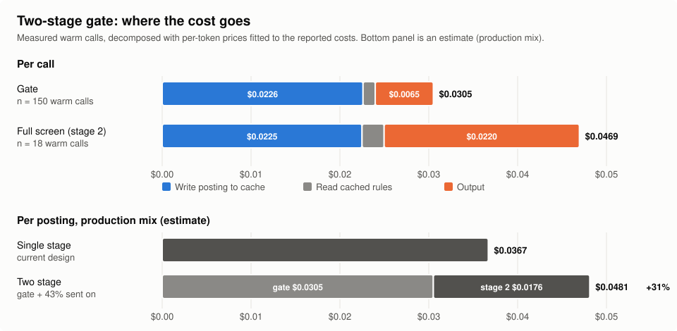

# Two-stage screening gate

**Status: evaluated, not adopted.** Production keeps the single-stage, single-turn screening worker.

**Conclusion.** A short "hard-reject gate" call in front of the full screen was safe in this
sample: no historical ACCEPT was rejected (0 / 35), and all 55 gate rejects were judged correct in
a case-by-case review. It still made screening more expensive. On the production mix, the
estimated cost per posting rises from $0.0367 to $0.0481 (**+31%**), because every call has to write
the whole posting into the prompt cache, and every posting the gate passes on pays that write twice.

Experiment date: 2026-10-07. Model: the same model for both stages (`claude-opus-5-5`). 170 model
calls, $5.68 at list price.

**How to read the labels in this report**

| Label | Meaning |
|---|---|
| **measured** | taken from the usage / result of a real model call in this run |
| **estimated** | computed from measured values plus inputs that were not measured in this run (baselines, production mix) |
| **automatic check** | deterministic code (schema, verbatim-anchor check, routing rule) |
| **Claude review** | case-by-case reading by Claude (an LLM) against the JD and the rules. No person re-checked these verdicts |
| **unverified** | stated in the original notes but not reproducible from the published data |

"Historical" decisions are the production worker's own earlier decisions, not independent human labels.

## 1. Problem and hypothesis

Most postings fail on a hard rule: required years of experience, seniority, language, student
eligibility. The production worker reads the full posting and the full candidate profile for each
one. **Hypothesis:** a short gate prompt can end the clear-cut rejects cheaply, so the full screen
only runs on the rest, and total cost falls **without a single extra false reject**.

## 2. What differs from production

| | Production (single stage) | Evaluated design (two stage) |
|---|---|---|
| Calls per posting | 1 | 1 (gate) + 1 more for every posting the gate does not end |
| Gate prompt | — | gate rules + 17 candidate facts, each traced to a profile section; about 40% of the full prompt (10.6k vs 26.2k characters). No full profile, no responsibility rubric |
| Gate output | — | `REJECT` (must be `HIGH` confidence, with a hard-reject type and a verbatim anchor), `PASS` or `UNCERTAIN` |
| Routing | — | only `REJECT` + `HIGH` ends a posting; everything else, a parse failure included, goes to stage 2 |
| Stage 2 | — | the unchanged production worker (same system-prompt hash) |
| Conservative rules | — | 1–2-year requirements, "preferred" / "typically" wording, alternative paths ("or equivalent"), licences, specialised-domain judgements and title-only seniority always go to stage 2 |

## 3. Method

- **Sample (stratified, seed 20261008).** 150 postings from a deduplicated pool of 650 screened on
  two production days, stratified by historical outcome. All 35 historical ACCEPTs in the pool are
  included and ran first, under a stop rule: the run would have stopped if the gate rejected any of
  the first 20 with high confidence. The sample over-represents ACCEPTs (23% vs 5.4% of the pool),
  so sample routing rates are not production rates; section 5.3 reweights them.
- **End to end.** A 30-posting subset ran through both stages.
- **Control.** The single-stage baseline is the production worker's cost from the earlier paired
  single-turn benchmark ([screening_single_turn.md](../../docs/benchmarks/screening_single_turn.md)):
  $0.0436 per posting overall and per-stratum means (n = 1–6 calls each). It was not re-run here.
- **Run checks (automatic).** 170 calls, 0 retries, every call single-turn, tool-free and on one
  model. The gate's cached prefix stayed at 6,838 tokens on every warm call, below the 12,373-token
  prefix of the full prompt, so the gate never loaded the full profile.
- **Review (Claude review).** 139 cases were read against the JD and the rules: all 55 gate rejects
  (±350 characters around the anchor plus every "equivalent / preferred / asset / bonus" in the
  JD), all 35 ACCEPTs, the 33 historical hard rejects the gate passed on, every French-language,
  ≤2-year and title-only-seniority case, and both end-to-end disagreements.
- **Metrics.** Gate reject precision (Claude review); historical ACCEPTs ended by the gate; output
  format failures; share sent to stage 2; cost and tokens per call and per posting; latency.

## 4. Results

### 4.1 Quality

| Metric | Result | Evidence |
|---|---|---|
| Postings ended by the gate | 55 / 150 (36.7%) | measured |
| Gate rejects judged correct | **55 / 55** (Wilson 95%: 93.5%–100%) | Claude review |
| Anchor supports the reject | 55 / 55 | Claude review |
| Gate anchors that pass the verbatim check | 120 / 120 non-empty anchors | automatic check (original run; anchors are not published) |
| Historical ACCEPTs ended by the gate | **0 / 35** (Wilson 95% upper bound 9.9%) | measured |
| Output format failures | 1 / 150 (prose before the JSON); routed to stage 2 | automatic check |
| Sent to stage 2 | 95 / 150 (63.3%) | measured |
| End to end: final decision equals the historical one | 28 / 30 | measured |

Ended by the gate, per stratum (measured): REQUIRED_EXPERIENCE 19/25, SENIORITY 11/15, LANGUAGE
12/15, STUDENT_ELIGIBILITY 9/10, MANDATORY_QUALIFICATION 4/8, and 0 of ACCEPT (35),
REJECT without a hard rule (22), SPECIALIZED_EXPERIENCE (15, by design) and UNABLE (5).

0 / 35 bounds the false-reject rate below about 10%; it does not show the rate is zero.

### 4.2 Cost per call



Per-token prices fitted to the 170 measured calls (cache write $8.00, cache read $0.20, output
$20.00 per million tokens) reproduce every reported cost to within $0.000005, i.e. the fitted
decomposition agrees with the reported costs within rounding error:

| Warm call (mean) | Write posting to cache | Read cached rules | Output | Total (95% bootstrap) |
|---|---|---|---|---|
| Gate (n = 150) | **$0.0226 (74%)** | $0.0014 | $0.0065 | $0.0305 ($0.0292–0.0318) |
| Stage 2 (n = 18) | **$0.0225 (48%)** | $0.0025 | $0.0220 | $0.0469 ($0.0417–0.0515) |

- Both stages have to read the whole posting, and it is written to the cache on every call at 40×
  the cache-read price. A posting the gate passes on pays that write twice.
- The shorter gate prompt only shrinks the cache *read*, which was already almost free.
- The single-stage worker already stops early on hard rejects (short output), so ending one of
  them at the gate saves little: those postings cost about $0.033 in a single stage (estimated).

### 4.3 Cost per posting

| Scenario | Single stage | Two stage | Change | Evidence |
|---|---|---|---|---|
| Sample mix: gate + 63.3% × stage 2 | $0.0436 | $0.0603 | **+38%** | estimated (measured gate and stage 2, baseline single stage) |
| Production mix: pool strata × per-stratum gate rates, 42.6% to stage 2 | $0.0367 | $0.0481 | **+31%** | estimated |
| 30 postings end to end (stage-2 cold start replaced by the warm mean) | $0.0420 (counterfactual) | $0.0616 | +47% | two stage measured; single stage estimated |
| Input-side tokens per posting, sample mix | 15,088 | 19,283 | +28% | estimated |
| Latency per posting, production mix | 12.5 s | 12.5 s | none | estimated; routed postings wait ~7 s longer |

**Break-even (estimated).** Compare like with like: the postings the gate ends would have cost
$0.0333 each in a single stage, and a gate call costs $0.0305. The gate pays off only if at most
**~8%** of postings go on to stage 2, and even a gate that ended every posting would save only
~8%. Observed: 63% in the sample (measured) and 43% on the production mix (reweighted estimate).
The original 2026-10-07 write-up rounded
this to ~9% from a rounded $0.0335; the script reproduces 8.3%.

## 5. Cases

- **Near misses handled correctly (Claude review).** Three historical ACCEPTs stated 3+ years but
  only as a preference: "3–5 years' experience … preferred" (G008), years listed under "even better
  if you have, but not necessary" (G009), "3+ years … preferred" (G034). The gate sent all three to
  stage 2. A keyword or regex pre-filter would have rejected them.
- **Rule wording looser than its intent.** In G059, G060 and G086, "or equivalent" referred to the
  degree, not to the years. The gate rule literally said "no 'or equivalent'"; the model applied
  the intended meaning and rejected on the years. The rule text should have said "no alternative
  path for the years".
- **Format failure, handled safely.** G116 wrote one sentence before a valid JSON object. The parser
  rejects that, and the posting went to stage 2 as designed.
- **Type label, not decision, differed.** For a co-op posting that violated two rules (student
  status and a language-test note), the gate chose STUDENT where the history said LANGUAGE.
- **End-to-end disagreements came from stage 2.** G012 (historical ACCEPT): the gate passed it on;
  stage 2 rejected it this time on a specialised-domain requirement. G041 (historical REJECT):
  stage 2 accepted it this time. Both are boundary cases of the production worker re-run, at the
  rate seen in the earlier benchmark ([19 / 20 re-run agreement](../../docs/benchmarks/screening_single_turn.md#productions-own-re-run-noise-as-a-baseline)), not gate errors.

## 6. Decision

Not adopted. Quality was not the reason. With the same model in both stages, the cost structure
(posting write on every call, cheap early stops in the existing worker, a gate that must stay
conservative) means no realistic routing rate saves money. The design would also add a second
prompt that must stay in sync with the screening rules, and a second place where output can fail
to parse.

**Re-evaluate when:**
- a much cheaper gate model is available: the gate must cost ≤ $0.019 per call to break even on
  the production mix and ≤ $0.012 (about 40% of today's) to save 20% (estimated). A cheaper model
  running the *single-stage* worker avoids the double write entirely and is the better experiment;
- the provider's pricing changes the ratio between writing and reading cached input;
- a deterministic pre-filter for unambiguous patterns ("currently enrolled", "French required")
  is considered. It costs nothing per call, but the near misses above show its false-reject risk,
  so it needs its own precision study first.

## 7. Reproduce

```bash
python3 experiments/two_stage_gate/scripts/analyze_gate.py --check
```

Standard library only, no model call. It reads [`results/`](results/) and rewrites
`results/analysis.json` and `results/cost_breakdown.svg`; `--check` fails if the headline numbers
above no longer follow from the data. What is published:

| File | Content |
|---|---|
| [`calls.csv`](results/calls.csv) | one row per model call (170): stage, stratum, routing outcome, tokens, cost, latency, turns, failure kind |
| [`samples.csv`](results/samples.csv) | the 150 sampled postings: stratum and historical decision |
| [`review_outcomes.csv`](results/review_outcomes.csv) | the 139 reviewed cases: why each was reviewed and the verdict flags (Claude review) |
| [`inputs.json`](results/inputs.json) | single-stage baselines and the production mix, with their sources |

Sample IDs (G001…) are local to this experiment. Postings, companies, URLs, anchors, model
reasons, review notes and prompts are not published.

**What cannot be reproduced from this repository:** the gate calls themselves. The gate prompt
embeds facts about the real candidate and the private screening rules, and the call script imports
private screening code, so neither is published. The review verdicts are published as flags only,
without the JD text they were judged against.

## 8. Limitations

- One stratified sample from two production days; strata have 5–40 postings, so per-stratum rates
  are rough and the production-mix figures are estimates.
- The single-stage baseline comes from an earlier benchmark (per-stratum n = 1–6), not from a
  concurrent control run.
- The quality review was performed by Claude, not by a person, and "historical" decisions are the
  pipeline's own earlier outputs. The quality result is "no problem found by this review", not a
  measured error rate against independent labels.
- One model, one pricing scheme (prompt-cache write at 40× the read price). The cost conclusion
  depends on that ratio.
