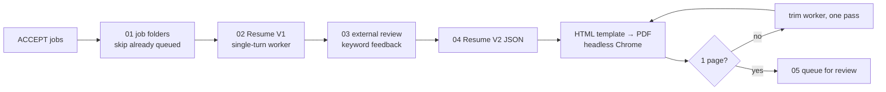

# Resume generation

## Purpose

Turn every unique ACCEPT from [screening](../screening/README.md) into a tailored, one-page resume
built only from the candidate's own fact library, and put it in a queue for a person to review.
Five stages, each a script under [`script/`](script/), run in order by [`run_pipeline.py`](../run_pipeline.py).

## Inputs and outputs

| Stage | Reads | Writes |
|---|---|---|
| `01_prepare_jobs.py` | newest `screening/output/*_jobs.json` | one folder per job with `job.json` (company, position, jd, apply_url, source_key); a row in `pipeline_tracker.csv` |
| `02_generate_v1.py` | `job.json` + candidate files | `resume_v1` (plain text) in `job.json`; `v1_ready.json` handoff |
| `03_review_resumes.py` | `v1_ready.json` | `quality_feedback` in `job.json`; `feedback_ready.json` ([scoring](../scoring/README.md)) |
| `04_generate_final.py` | `feedback_ready.json` | `resume_v2` (structured JSON), `resume.html`, `resume.pdf` |
| `05_enqueue_applications.py` | tracker rows with `final_status == DONE` and `pdf_pages == 1` | new `status: TODO` rows in `application_list.json` |
| `generate_cover_letter.py` | one job folder, on request | `cover_letter.html`, `cover_letter.pdf` |

Job folders live under `<workspace>/resume/jobs/<batch>/`. The **candidate files** come from
`<candidate_dir>` ([`examples/candidate/`](../examples/README.md) by default): `candidate.json`
(name, contact, fixed experience and education lines) and the knowledge files it names (one bullet
bank per employer, a project library, a skills list).

## How it works



**Generation context.** The default worker is single-turn and tool-less
([`common/single_turn.py`](../common/single_turn.py)). Its system prompt embeds, in full, the
worker role, the stage's rule file ([`instructions/resume_v1.md`](instructions/resume_v1.md) or
`resume_v2.md`) and the candidate files. The user prompt is the job: company, position and the
untrusted description, plus Resume V1 and the review feedback for V2. Because the candidate part is
identical for every job, it is served from the prompt cache after the first call.

**Earlier path.** `--worker agent` (or `LJP_RESUME_WORKER=agent`) runs the previous design,
`claude -p --agent <worker>` with the `Read` tool, from a private staged copy of the files
([`common/worker_dir.py`](../common/worker_dir.py)). It is kept for rollback; the
[benchmark](../docs/benchmarks/resume_single_turn.md) compares the two.

**Rendering and fit.** V2 is a JSON object that Python places into a fixed HTML template; the
header is filled from `candidate.json`, never from model output. Headless Chrome prints the PDF and
PyMuPDF counts its pages. Over one page, a trim worker makes one shortening pass and the PDF is
rendered again, up to `--max-trim-iterations` (default 6); a resume still over one page ends as
`LAYOUT_FAILED` and is not queued.

## What is checked, and what is not

| Check | Where |
|---|---|
| V1 contains the candidate's name, every employer and school, the five section headings and the job title; no HTML | `validate_resume` in [`02_generate_v1.py`](script/02_generate_v1.py) |
| V2 schema; experience role / company / date and education match `candidate.json`; a trim pass changes no identity field, adds nothing and gets shorter | [`04_generate_final.py`](script/04_generate_final.py) |
| No links or e-mail addresses except the candidate's own, no credential-like strings, no fragments of the worker's prompt | [`common/output_guard.py`](../common/output_guard.py), on V1, V2, trims and cover letters |
| Exactly one page | PDF page count |

These are structural and safety checks. **They do not verify that each bullet is factually
supported by the fact library.** The "unsupported numbers" figure in the benchmark comes from an
evaluation script ([`eval/benchmark_resume_single_turn.py`](../eval/benchmark_resume_single_turn.py)),
not from a production check, and it only looks at numbers.

## Where a person steps in

- **The application queue.** Stage 5 only adds `TODO` rows; a person reviews each resume and decides
  whether to apply. Nothing in this repository submits an application.
- **Manual recovery in quality review**, see [scoring](../scoring/README.md#where-a-person-steps-in).
- **Cover letters** are generated one job at a time, only when an application asks for one.

## Design choices

- **The model writes text; Python owns every file.** Workers return one JSON object; stages validate
  it and write `job.json`, the tracker and handoffs atomically. One job = one fresh worker.
- **Identity is never generated.** Name, contact, employers, dates and education are fixed by
  `candidate.json` and checked, so a prompt-injected description cannot change them.
- **Handoff manifests between stages.** Each stage reads the previous stage's manifest instead of
  scanning folders, and skips jobs that are already done, so reruns continue where they stopped.
- **Full text rather than retrieval.** An alternative that retrieves only the relevant facts
  (BM25 + TF-IDF/LSA) was built and evaluated on six development jobs and **not adopted**; it is not
  used in production ([experiments/candidate_fact_rag](../experiments/candidate_fact_rag/README.md)).

## Run

From the repository root. Stages 2 and 4 make real model calls unless `--dry-run` is given:

```bash
python3 run_pipeline.py --from resume                       # stages 1-5 in order
python3 resume/script/02_generate_v1.py --dry-run
python3 resume/script/02_generate_v1.py --batch <batch-folder> --job <job-folder> --force   # redo one job
python3 resume/script/04_generate_final.py --limit 1 --workers 1
python3 resume/script/05_enqueue_applications.py --dry-run
```

Stage 4 needs Chrome or Chromium (`CHROME_BIN` if it is not found) and PyMuPDF. The offline path is
the [demo](../demo/README.md).

## Validation and limitations

- Tests: `python3 tools/run_tests.py resume` (queueing and telemetry). Stages 2–5 run end to end in
  the [demo](../demo/README.md) and in CI.
- [Benchmark](../docs/benchmarks/resume_single_turn.md): single-turn vs. agent workers on 8 jobs
  plus 3 prompt-injection cases.
- Real-use notes, including V1 validation failures and reruns:
  [operational experience](../docs/operational_experience.md#resume-v1-output-failing-the-structural-check).
- Resume workers call the Claude Code CLI directly; they do not use `common.llm`, so
  `--backend api` does not apply here.

## Key files

| File | Role |
|---|---|
| [`script/02_generate_v1.py`](script/02_generate_v1.py) | V1 controller, worker modes, V1 validator |
| [`script/04_generate_final.py`](script/04_generate_final.py) | V2, HTML/PDF rendering, page check, trim loop |
| [`script/01_prepare_jobs.py`](script/01_prepare_jobs.py), [`script/05_enqueue_applications.py`](script/05_enqueue_applications.py) | job folders in; queue out |
| [`script/pipeline_telemetry.py`](script/pipeline_telemetry.py) | per-attempt usage records (counters only) |
| [`instructions/`](instructions/) | model-facing rules for V1, V2, trim and cover letter |
| [`templates/`](templates/) | fixed HTML layouts for resume and cover letter |
