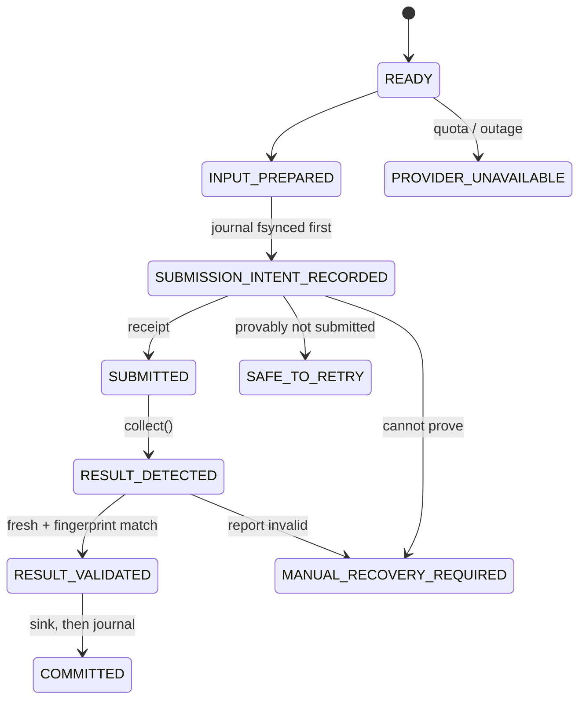

# Scoring (resume quality review)

## Purpose

Send each Resume V1 to an **external reviewer** that scores it against the job description, and
turn the report into structured feedback (matched and missing skills) for Resume V2. It runs as
stage 3 of [resume generation](../resume/README.md), between V1 and V2.

This is not [screening](../screening/README.md). Screening decides whether the candidate fits a
posting, with a model. Scoring asks how well one generated resume covers one description's
keywords, through a provider outside the pipeline. **Stage 3 makes no model calls.**

The package is provider-agnostic. Its main job is to make calls to a provider that may have a paid
quota **exactly-once and crash-safe**: never submit the same resume twice by accident, never lose a
submission that did happen, never accept a stale or mismatched report.

## Inputs and outputs

| | |
|---|---|
| Input | a `ReviewJob`: job ID, Resume V1 text, job description (from `job.json`) |
| Provider call | `submit()` once, then `collect()` until a `QualityReport` is ready |
| Committed result | `quality_feedback` (+ `quality_review` metadata) written into `job.json` by the stage's sink |
| Per-job journal | `<workspace>/resume/.runtime/review_journal/<batch>/<job>.json` |
| Handoff | `feedback_ready.json`: the jobs whose `quality_feedback` is valid, for stage 4 |
| Telemetry | `review_events.jsonl`: states and counters only, jobs identified by a salted pseudonym |

## Providers: what actually exists

| `--provider` | What it is | Real external service? |
|---|---|---|
| `mock` (default) | [`mock.py`](mock.py): offline keyword coverage of the description by the resume over a fixed skill list. Used by CI, tests and the demo | no |
| `manual` | [`manual.py`](manual.py): writes a request file to a private inbox; a person writes the report file; a later run collects it | a person, not a service |
| `module:factory` | any object implementing the [`ResumeScorer`](models.py) protocol, loaded from `PYTHONPATH` | only if you write one |

**No adapter for a commercial scoring service is included.** The author's private setup uses one;
it is out of scope here. Scores from `mock` are a deterministic keyword ratio, not an ATS score.

## How it works



Every transition is listed in [`states.py`](states.py); any other one raises.

## Design choices

- **Intent before action, never resubmit blindly.** The intent is fsynced before `submit()` is
  called. If a run dies after that point, the next run asks the provider (`lookup()`, if it has
  one); if the provider cannot confirm, the job becomes `MANUAL_RECOVERY_REQUIRED` and is never
  resubmitted automatically. The trade-off: some ambiguous cases need a person.
- **Only fresh, matching reports are accepted.** A report must be newer than the submission, must
  not be the report that existed before it, and must echo the fingerprint of the exact resume and
  description submitted. Feedback must also pass a strict schema (`validate_feedback`).
- **Commit, then checkpoint.** The report is written to `job.json` first and the journal moves to
  `COMMITTED` second; a crash in between is repaired by re-committing the journaled report.
- **Quota or outage stops the run.** `PROVIDER_UNAVAILABLE` ends the run (exit 3) and writes
  `review_blocked.json`; stage 4 refuses that batch until stage 3 is rerun.

There is no model cost to budget here. The limits are the provider's: polling is bounded per run
(`--max-polls`, `--poll-interval`), and a report that is not ready yet leaves the job
`PENDING_RESULT` for the next run, without resubmitting.

## Where a person steps in

- the `manual` provider: writing reports;
- `MANUAL_RECOVERY_REQUIRED`: after checking the provider, mark a job not submitted
  (`--resolve-not-submitted`) or adopt a report by hand (`--adopt-report`), both with `--note`;
- `PROVIDER_UNAVAILABLE`: deciding when to retry.

See [operational experience](../docs/operational_experience.md#human-intervention).

## Run

From the repository root, after stage 2 has written a `v1_ready.json` handoff:

```bash
python3 resume/script/03_review_resumes.py                      # newest batch, mock provider
python3 resume/script/03_review_resumes.py --dry-run            # plan only, no provider calls
python3 resume/script/03_review_resumes.py --provider manual --inbox ~/private-review-inbox
python3 resume/script/03_review_resumes.py --batch <batch> --resolve-not-submitted <job-folder> --note "checked provider"
python3 resume/script/03_review_resumes.py --batch <batch> --adopt-report <job-folder> report.json --note "from provider UI"
```

The manual inbox holds full resume and description text: it must be private (a group- or
world-readable inbox is refused), and request files are deleted once the report is committed.

## Validation and limitations

- Tests: `python3 tools/run_tests.py scoring` — crashes injected at each step, lost connections,
  stale and mismatched reports, corrupt journals, quota exhaustion, operator actions.
- The engine has only been exercised publicly with `mock` and `manual`; no real-service adapter is
  tested in this repository.
- Keyword coverage measures wording overlap, not resume quality or factual accuracy.

## Key files

| File | Role |
|---|---|
| [`engine.py`](engine.py) | the review engine and its safety rules; `validate_feedback` |
| [`states.py`](states.py) | state machine and allowed transitions |
| [`journal.py`](journal.py) | fsynced per-job journal |
| [`models.py`](models.py) | `ResumeScorer` protocol, `QualityReport`, fingerprints |
| [`providers.py`](providers.py), [`mock.py`](mock.py), [`manual.py`](manual.py) | provider selection and the two built-in providers |
| [`../resume/script/03_review_resumes.py`](../resume/script/03_review_resumes.py) | the pipeline stage that drives the engine |
