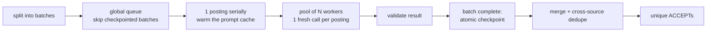

# Screening

## Purpose

Decide, for every posting that [discovery](../discovery/README.md) kept, whether the candidate has
actually done the core work of the role. One isolated model call reads one full job description
against the candidate's capability profile and a fixed rubric, and returns a structured decision
that quotes the description as evidence. Unique ACCEPTs go on to [resume generation](../resume/README.md).

## Inputs and outputs

| Step | Reads | Writes (under `<workspace>/screening/`) |
|---|---|---|
| `split_greenhouse.py`, `split_ashby.py` | newest `discovery/<source>/outputs/*_jobs.json` | `input_batches/<platform>/<date>_<platform>_batch_NNN.json` (≤ 10 postings each) |
| `scripts/02_run_screening.py` | the day's batches; rubric and profile | `results/<platform>/<date>/result_NNN.json` (one checkpoint per batch) |
| `scripts/03_merge_results.py` | batches + checkpoints | `.runtime/<date>/screened_all.json` (every record) and `output/<date>_<HHMM>_jobs.json` (unique ACCEPTs only) |
| `scripts/04_rescreen_eligibility.py` | existing checkpoints | the same checkpoints, with re-screened results replaced in place |

The model sees `source_key`, `position` and `jd` only. The rubric is
[`instructions/screen_job.md`](instructions/screen_job.md); the profile is
`<candidate_dir>/capability_profile.md` (the fictional one in [`examples/`](../examples/README.md)).

One result, abridged:

```json
{"source_key": "...",
 "hard_reject": {"hit": false, "type": null, "jd_anchor": null},
 "core_responsibilities": [{"responsibility": "...", "jd_anchor": "<verbatim JD text>", "match": "DIRECT"}],
 "anchor_direct_match": "...", "main_gap": {"type": "ADJACENT", "description": "..."},
 "decision": "ACCEPT", "reason": "..."}
```

A full real-model example is in the [root README](../README.md#example-one-screening-decision).

## How it works



The rubric works in order: a **hard-reject check** (seniority, required years, specialised
experience, student eligibility, language, mandatory qualification), then 3–5 **core
responsibilities**, each matched as DIRECT / ADJACENT / LEARNABLE / STRUCTURAL, then the main gap and
the decision. A posting with an empty description gets a local `UNABLE TO ASSESS` without a model
call, unless its title may be French (a French title alone can justify a language reject).

## Design choices

- **Single-turn, tool-less worker by default.** The rubric and profile are embedded at the start of
  the system prompt, so every call after the first reads them from the prompt cache and writes
  only the posting. The earlier `Read`-tool agent worker is kept as `--worker agent` for rollback.
  This is the change behind the [−82.3% cost result](../docs/benchmarks/screening_single_turn.md).
- **Evidence must be verbatim.** After quote / dash / whitespace normalisation, every `jd_anchor`
  must appear in the description (a LANGUAGE reject may quote the title instead), otherwise the
  result is rejected ([`screening_core.validate_result`](scripts/screening_core.py)).
- **Batch checkpoints, failures classified.** A batch is written only when every posting in it is
  valid, so a rerun skips finished work. A transient error gets one fresh-worker retry; an invalid
  output is not retried in single-turn mode; an environment failure (not logged in, 401 / 403, a
  rejected CLI command) stops the whole run without checkpointing partial batches.
- **Guardrails on every call.** The run stops if a call takes more than one turn, uses a tool,
  changes model, runs with a system prompt whose hash differs from the source files, or shows
  unexpected extra context in its cached prefix.
- **Duplicates are found by content, not company name.** At merge, two postings are duplicates
  when ≥ 80% of the shorter title's words appear in the other and their descriptions share ≥ 85% of
  5-word shingles. Records are kept and marked `duplicate_of`; counts and ACCEPTs cover unique jobs.

## Run

From the repository root. These make real model calls unless `--dry-run` is given:

```bash
python3 run_pipeline.py --from screening --until screening      # split → screen → merge
python3 screening/scripts/02_run_screening.py --dry-run          # validate batches and checkpoints only
python3 screening/scripts/02_run_screening.py --workers 3 --max-budget-usd 15
python3 screening/scripts/02_run_screening.py --backend api      # Messages API (single-turn only)
python3 screening/scripts/03_merge_results.py --date 2026-10-01
python3 screening/scripts/04_rescreen_eligibility.py --date 2026-10-01 --scope language --dry-run
```

`--max-budget-usd` reserves an estimate before each launch and stops starting new workers once the
cap would be exceeded; running calls finish, so it is a soft cap. The offline path is the
[demo](../demo/README.md).

## Observed operation

Historical runs of the private setup, at the version of the time, on 9 run days from 2026-10-01 to
2026-10-10 (no run on 10-05). They are not a re-run of the two published adapters and not an
accuracy evaluation; only aggregate counts are reported here.

| From the merged daily results | |
|---|---|
| Screening records | 2,846 (163–451 per day) |
| Marked as duplicates at merge | 160 (5.6%) |
| Unique postings, summed over days | 2,686 |
| ACCEPT | 168 (6.3% of unique) |
| REJECT | 2,502 (93.1%) |
| UNABLE TO ASSESS | 16 (0.6%) |

The records cover the five private sources that reached screening; the full collection setup
covers seven platforms. A record is not a model call: reruns add calls without adding records, and
an empty description is decided locally. Duplicates are removed within each day only, with no
extra content dedupe across days, so the unique total is a sum of daily counts.

**Cost.** The six single-turn run logs that were kept, including runs kept as backups and the
recovery reruns, record 1,890 calls at a CLI-reported list-price equivalent of $70.7237, about
$0.03742 per call. Each log is a separate run, so no run is counted twice. This is not
subscription cash spend, and 1,890 calls are not 1,890 distinct postings.

**Recovery, 2026-10-08.** The day's main run made 328 calls. One answer was not valid JSON, so its
batch was not checkpointed; the other 34 of 35 batches were. Each of two reruns skipped the
checkpointed batches and re-screened only that batch's 10 postings: the first hit the same
failure, the second passed. Recovery cost 20 extra calls and $0.6516
([details](../docs/operational_experience.md#one-unparseable-answer-blocked-one-batch-not-the-run)).

## Validation and limitations

- Tests: `python3 tools/run_tests.py screening` (validator, guardrails, retries, the API backend
  against a fake SDK).
- Benchmark: [single-turn vs. agent worker](../docs/benchmarks/screening_single_turn.md) — cost,
  96 / 100 agreement with prior decisions, and production's own re-run noise.
- What the validator proves: the result has the right shape, the decision is consistent with a
  hard-reject hit, and every quoted anchor exists in the description. What it does not prove:
  that the anchor supports the judgement, that the match labels are right, or that the decision
  follows from them. Agreement is measured against the pipeline's own earlier decisions, not
  independent human labels.
- One rubric rule is under-specified (a hard 1–2-year minimum), and borderline postings can flip
  between runs. See [operational experience](../docs/operational_experience.md#open-problems).
- A rejected-by-measurement alternative, a cheap gate before this stage, is documented in
  [experiments/two_stage_gate](../experiments/two_stage_gate/README.md).
- A real failure and its recovery through batch checkpoints:
  [operational experience](../docs/operational_experience.md#one-unparseable-answer-blocked-one-batch-not-the-run).

## Key files

| File | Role |
|---|---|
| [`scripts/02_run_screening.py`](scripts/02_run_screening.py) | daily controller: queue, warm-up, worker pool, checkpoints, progress protocol |
| [`scripts/screening_core.py`](scripts/screening_core.py) | worker modes, prompt building, validation, guardrails, budget, retry |
| [`scripts/03_merge_results.py`](scripts/03_merge_results.py) | completeness check, merge, cross-source dedupe, handoff file |
| [`scripts/04_rescreen_eligibility.py`](scripts/04_rescreen_eligibility.py) | targeted re-screen after an eligibility-rule change |
| [`instructions/screen_job.md`](instructions/screen_job.md) | rubric and output contract (model-facing) |
